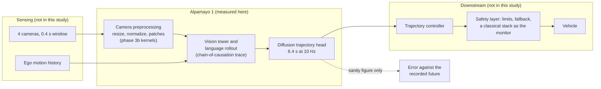

# Case study 02: Alpamayo 1, an AV reasoning model, on the bench and the edge

**Question:** what does one driving decision from NVIDIA's open Alpamayo 1 model
cost on the hardware in this lab, in time, memory and power, and how much of the
bench's performance survives on a Jetson?

Alpamayo 1 (`nvidia/Alpamayo-R1-10B`, 10B parameters, weights under OpenMDW-1.1,
inference code Apache-2.0) reads four cameras over 0.4 s plus the ego vehicle's
recent motion, writes a chain-of-causation reasoning trace, and samples a 6.4 s
trajectory at 10 Hz. Every number here comes from a committed JSON record on a
named board, as in case study 01.

**Status: phases 2 to 4 and 3b done.** Both boards are measured and profiled, the two preprocessing kernels are verified and timed on both boards and the separable one beats PyTorch's own ops, and the standalone C++ driver matches the extension bit for bit. Results below come from the
committed JSON only; a cell says "pending" until the run that produces it is committed.

## Boards

| Board | Role | Target for | State |
|---|---|---|---|
| RTX 5090 (`bench-5090`) | bench | full-precision run, profile, plots | measured, sdpa and flash-attn (phase 2); profiled (phase 3); kernels (phase 3b) |
| Jetson AGX Thor (`bench-thor`) | edge bench | same clips, with power | measured, sdpa, board power (phase 4); profiled (phase 3 on the edge); kernels (phase 3b); JetPack, not DriveOS |
| Jetson Orin NX 8 GB (`field-orin`) | field | nothing | does not fit; measured facts in [ORIN_NX.md](ORIN_NX.md) |

## Results

Measured values only, from the committed JSON under `runs/`. The table is the
output of `plot_results.py --table` (phase 3) and is regenerated, not edited,
when a run is added. Protocol: eight clips, one warm-up decision excluded, three
decisions per clip, upstream sampling defaults, seed 42 before each decision.
Power on the 5090 is the GPU rail from NVML; power on the Thor is the whole
board (`VIN` from tegrastats). The two power rows are therefore not like for
like; the Thor figure includes CPU, memory and carrier board.

| Metric | RTX 5090, flash-attn | RTX 5090, sdpa | Jetson AGX Thor, sdpa |
|---|---|---|---|
| Model load time | 8.3 s | 15.7 s | 25.9 s |
| Latency per decision, median | 0.93 s | 0.89 s | 4.38 s |
| Latency per decision, p95 | 1.24 s | 1.16 s | 5.88 s |
| Time to first token, median | 0.37 s | 0.38 s | 1.84 s |
| Decode rate, median | 50.9 tok/s | 60.0 tok/s | 9.7 tok/s |
| Reasoning tokens, median | 18 | 18 | 18 |
| Decisions per minute | 64.3 | 67.8 | 13.7 |
| GPU memory after load | 20.6 GiB | 20.6 GiB | 20.6 GiB |
| Peak GPU memory during a decision | 21.5 GiB | 21.5 GiB | 21.5 GiB |
| Power during a decision, median | 359 W | 377 W | 64 W |
| Energy per decision, median | 323 J | 316 J | 290 J |
| Decisions | 24 (8 clips x 3) | 24 (8 clips x 3) | 24 (8 clips x 3) |


The flash-attn column is flash-attn 2.8.3 on the VLM with sdpa kept on the
diffusion expert (PLAN.md, Amendments). On this GPU, at batch size one and
these sequence lengths, it is slower than sdpa in decode (50.9 against 60.0
tokens per second) and equal in time to first token, so sdpa stays the
baseline and is the variant the Thor is compared against.

## Where the time goes (phase 3, 5090, sdpa)

One decision on clip `030c760c` under `torch.profiler`, after one warm-up,
from `runs/profile_bench-5090_sdpa.json`. The profiler adds overhead: this
decision took 1.01 s against 0.94 s for the same clip in the
unprofiled run, so the split below is read as shares, not as the latency.

| Stage | Device time | Share of the decision |
|---|---|---|
| Vision tower (inside the rollout) | 117 ms | 12 % |
| Language rollout: prefill and 22 decode steps | 784 ms | 78 % |
| Trajectory sampling (diffusion expert) | 223 ms | 22 % |
| Whole decision | 1009 ms | 100 % |

- The first token arrives at 0.39 s; after that the decode runs at one token every
  19 ms (53 tokens per second under the profiler). With a median
  of 18 reasoning tokens, decode is the largest single block of a decision,
  and a longer trace costs 19 ms per extra token (`report/tokens_vs_latency.svg`).
- The kernel table says what that decode is: the two largest kernels are a
  cutlass bf16 tensor-op GEMM (23 % of kernel
  time, prefill and the diffusion head) and a bf16 GEMV (17 %
  plus 8 % in a second instance), which is the
  batch-one decode streaming the 8B weights once per token. Attention is third
  (memory-efficient attention kernel, 9 %). sdpa on
  this stack dispatches to torch's own flash kernel for the prefill and to the
  memory-efficient kernel elsewhere.
- The kernel names carry `sm80` and `cutlass_80`: torch 2.8.0+cu128 runs its
  Ampere-generation kernels on this Blackwell GPU. There are no sm_120 specific
  GEMM or attention kernels in this build, which is one reason the flash-attn
  2.8.3 wheel (also built for older architectures) does not win either.
- The operator table overlaps by construction (`aten::linear` contains
  `aten::matmul` contains `aten::mm`), so its shares are of the table, not of
  the decision. The kernel table does not overlap.
- Plots under `report/`: `stage_split` (medians over all decisions, both
  variants), `latency_per_clip`, `tokens_vs_latency`, `memory`,
  `power_per_decision`, and `profile_timeline` (NVML power and utilisation
  around the profiled decision). SVG with a PNG next to each.

## Where the time goes on the Thor (phase 3 on the edge, sdpa)

The same profiler run on the Thor, same clip, one warm-up, from
`runs/profile_bench-thor_sdpa.json` (tree copied at commit `d7073fb`). The
profiled decision took 4.94 s against 4.38 s median
unprofiled, so again the split is read as shares.

| Stage | RTX 5090, device ms | Jetson AGX Thor, device ms | Thor as a share of the 5090 |
|---|---|---|---|
| Decision | 1009 | 4940 | 20 % |
| Rollout (prefill and decode) | 784 | 4080 | 19 % |
| Vision tower, inside the rollout | 117 | 756 | 15 % |
| Trajectory sampling | 223 | 854 | 26 % |
| Decode, per token (22 tokens) | 19 | 105 | 18 % |

- **Same shape, one fifth the speed, as the unprofiled runs said.** Every
  stage retains 15 to 21 percent; the vision tower retains the least, the
  trajectory head the most.
- **Different kernels.** The 5090's table is sm80 cutlass GEMMs and an
  sm80 memory-efficient attention kernel (torch 2.8.0+cu128 has no Blackwell
  kernels). The Thor's table is native `nvjet_sm110` bf16 GEMMs from torch
  2.11.0+cu130: the three largest, `nvjet_sm110_tst_128x8_64x12_2x1_v_bz_TNT`,
  `nvjet_sm110_tst_512x8_64x3_2x1_v_bz_splitK_TNT` and `nvjet_sm110_tst_256x256_64x4_2x1_2cta_v_bz_TNT`, take 39 percent of
  device time, and the decode is again a streamed weight read at batch one
  (`gemv2T` and the 128-row `nvjet` variants). The boards run the same
  model, not the same code.
- **Operators.** `aten::linear` 27 percent and `aten::matmul`
  22 percent of operator device time on the Thor; attention itself
  (`aten::scaled_dot_product_attention`) 3.0 percent.

## A custom CUDA kernel for the camera preprocessing (phase 3b)

Alpamayo's processor does three passes over each camera frame before the
vision tower sees it: an antialiased bicubic resize from 1080x1920 to
320x576, a rescale and normalize, and the 16x16 patch layout with 2x2 merge
and the temporal duplicate. `kernels/preprocess.cu` does that on the GPU
twice over, on purpose: a **fused** kernel, one pass, one thread per output
value, written to be read first; and a **separable** pair, a horizontal
pass into a float buffer and a vertical pass that rounds, normalizes and
scatters, written after the fused one was measured and found slow. The host
side is C++: `kernels/preprocess_torch.cpp` is the PyTorch binding (input
checks, allocation, the current stream, the launch check), and
`kernels/standalone/` is a driver that builds and runs the same kernels with
CMake and the CUDA toolkit alone, no PyTorch, and is compared with the
extension bit for bit. `KERNEL_WALKTHROUGH.md` explains all of it in plain
language. Built with the case study venvs only (SETUP.md), measured by
`bench_preprocess.py`, records in `runs/preprocess_<board>.json`. Measured
values only.

**Correctness.** `bench_preprocess.py` refuses to write a record unless both
variants agree with the processor's recipe run as PyTorch ops on the GPU
within one uint8 step after normalization (0.0078), and a test holds every
committed record to that gate. Both variants meet it on both boards; the two
variants agree with each other exactly (`separable_vs_fused` 0.0 in both
records). Against the PyTorch GPU path, one value in about 23,000 rounds to
the neighbouring grey level (`fraction_separable_vs_torch_gpu_one_step`
4.3e-5 on the 5090, 3.9e-5 on the Thor), which is float summation order at rounding ties.
Against the processor run on the CPU, where Alpamayo runs it today, the
kernels differ by up to five grey levels on 9.6 percent of values, and so
does the processor's own GPU path: the CPU uint8 resize uses fixed-point
weights and is not bit-identical to the float path. The model therefore sees
slightly different pixels depending on where preprocessing runs; the kernels
match the float path. The standalone driver's output equals the extension's
on both boards, and its C++ resampling tables equal the Python ones exactly.

**Time per 16-frame batch, one decision's input.** Wall time from CUDA
events; the three "under the profiler" rows are device time summed over the
kernels each path launches, from `torch.profiler`.

| Path, 16 frames | bench-5090 | bench-thor |
|---|---|---|
| kernel | 3.29 ms median, 3.39 ms p95 | 37.29 ms median, 37.42 ms p95 |
| kernel_separable | 0.65 ms median, 0.65 ms p95 | 10.74 ms median, 10.86 ms p95 |
| kernel+upload | 7.71 ms median, 7.93 ms p95 | 38.60 ms median, 38.91 ms p95 |
| kernel_separable+upload | 5.08 ms median, 5.52 ms p95 | 11.82 ms median, 12.20 ms p95 |
| torch_gpu | 1.23 ms median, 1.24 ms p95 | 15.63 ms median, 15.69 ms p95 |
| processor_cpu | 318.70 ms median, 384.86 ms p95 | 35.14 ms median, 53.76 ms p95 |
| Kernel time under the profiler, fused | 2.628 ms in 1 launches | 37.233 ms in 1 launches |
| Kernel time under the profiler, separable | 0.856 ms in 2 launches | 10.586 ms in 2 launches |
| Kernel time under the profiler, torch_gpu | 1.911 ms in 11 launches | 15.650 ms in 11 launches |
| Max abs error, fused vs torch GPU | 0.007843 | 0.007843 |
| Max abs error, separable vs torch GPU | 0.007843 | 0.007843 |
| Max abs error, fused vs processor on the CPU | 0.039216 | 0.031373 |

`kernel` is the fused kernel and `kernel_separable` the pair, frames already
on the GPU; `+upload` adds the host to device copy of the 100 MB of uint8
frames from pinned memory, which the CPU processor path does not need;
`torch_gpu` is the same recipe in PyTorch ops on the GPU; `processor_cpu` is
the Hugging Face processor on the CPU as Alpamayo calls it. The 5090 was
shared with an unrelated simulation process during these runs (about 4.2 GB
resident, NVML utilisation 87 percent just before the run, recorded in the
record); the kernel and the PyTorch path were timed back to back under the
same sharing, so their ratio stands, and an idle-GPU run is the thing to
add. The Thor was idle.

**Reading the numbers.**

- The fused kernel loses to PyTorch on both boards (3.29 against 1.23 ms on
  the 5090, 37.3 against 15.6 ms on the Thor) and the profiler says why: it
  is one kernel that gathers a 14 x 14 window of single bytes per output
  value, 196 loads where a separable resize needs 28, and on these GPUs the
  byte gathers are the cost, not the arithmetic.
- The separable pair beats PyTorch on both boards: 0.65 against 1.23 ms on
  the 5090 (1.9x), 10.7 against 15.6 ms on the Thor (1.5x). Under the
  profiler it is two launches, 0.86 ms of device time on the 5090, against
  PyTorch's eleven launches and 1.91 ms (`BicubicFilterFunctor` for the
  resize, then the elementwise rescale, normalize and copy kernels). The
  pair spends almost all of its time in the horizontal pass (0.75 of
  0.86 ms; 9.5 of 10.6 ms on the Thor), which still gathers single bytes at a
  stride of 3.3 input pixels between neighbouring threads. Vectorised byte
  loads or a shared-memory row tile are the next step and are not claimed.
- Where it matters: Alpamayo calls the processor on the CPU, 319 ms per
  decision on the 5090 host (24 cores, torchvision 0.23) and 35 ms on the
  Thor (14 cores, torchvision 0.26), against decision latencies of 0.89 s
  and 4.38 s. Any GPU path, PyTorch's or the separable pair, cuts that to a
  few milliseconds plus the upload (5.1 ms including the copy on the 5090;
  11.8 ms on the Thor, whose memory is shared with the CPU). The two CPU
  figures are not a like for like comparison of the two CPUs: the torchvision
  versions differ. They are recorded as measured.
- The standalone driver times the same kernels without PyTorch in the loop:
  0.65 ms and 3.04 ms on the 5090, 10.37 ms and 37.24 ms on the Thor
  (separable and fused, 50 runs), printed by the driver and not committed as
  records; they agree with the extension's timings, so the PyTorch binding
  adds nothing measurable.

## Trajectory error against the dataset's own future (sanity figure, not accuracy)

The runner records, for every decision, the average displacement error of the
sampled 6.4 s trajectory against the future the dataset recorded for that
clip (`min_ade_m_sanity_only` in the decision records), the way upstream's
own demo prints it. The protocol samples one trajectory per decision, so this
is the error of that one sample, not the multi-sample minADE of the model
card, and eight clips are not an evaluation set. It is here so the numbers
the boards produce can be seen to be driving-shaped, and because an
interviewer should be able to ask for it. From `plot_results.py --ade-table`,
enforced by `tests/test_alpamayo_results_table.py`:

| Clip | bench-5090, sdpa | bench-thor, sdpa |
|---|---|---|
| `030c760c` | 2.567 m | 1.452 m |
| `0347d9f9` | 1.664 m | 3.397 m |
| `06b483cf` | 1.869 m | 1.716 m |
| `09ad74a2` | 1.625 m | 2.949 m |
| `0a1ef808` | 2.099 m | 0.979 m |
| `0ea6fd88` | 0.357 m | 2.603 m |
| `174407b0` | 2.522 m | 1.011 m |
| `195f1fc6` | 2.514 m | 4.423 m |
| Mean over clips | 1.902 m | 2.316 m |

The two boards sample different trajectories for the same clip and seed
(different kernels, different rounding, a different sample; the friction log
records the same effect on the reasoning text), so the per-clip values are
not expected to match and their difference says nothing about either board.
The 2.567 m on the first clip equals what upstream's demo prints on this
host for the same clip.

## Where Alpamayo sits in an AV stack

What this case study measured is the model stage of an end-to-end reasoning
driver, on its own, with recorded sensor data and no vehicle. The diagram
places it; the lab measured only the box in the middle.



Alpamayo 1 replaces the hand-built perception, prediction and planning
chain of a modular stack with one model that reads the cameras and writes a
trajectory plus the reasoning behind it. It does not replace the controller
that tracks the trajectory or the safety layer that bounds it, and the
numbers here (latency, memory, power, decisions per minute) are the budget
such a layer would have to live inside: 13.7 decisions per minute on a
Jetson AGX Thor at 64 W is one decision every 4.4 s, which is a planning
cadence, not a control cadence. The study makes no claim about driving
performance.

## 5090 against Thor (phase 4)

Same model snapshot, same inference code, same eight clips, same protocol,
same seed, sdpa on both. The software differs where the Thor leaves no
choice: the 5090 runs the upstream pin, torch 2.8.0+cu128 on CUDA 12.8; the
Thor runs torch 2.11.0+cu130 on CUDA 13.0 (JetPack 7.1), because 2.8.0 does
not exist for that stack. transformers 4.57.1 and physical_ai_av 0.2.3 are
the same on both. The Thor is a Jetson AGX Thor developer kit on JetPack,
not a DRIVE AGX Thor on DriveOS. From `runs/decisions_bench-5090_sdpa.json`
and `runs/decisions_bench-thor_sdpa.json`:

| Stage or metric | RTX 5090, sdpa | Jetson AGX Thor, sdpa | Thor as a share of the 5090 |
|---|---|---|---|
| Latency per decision, median | 0.89 s | 4.38 s | 20 % |
| Time to first token, median | 0.38 s | 1.84 s | 21 % |
| Rollout (prefill and decode), median | 0.67 s | 3.53 s | 19 % |
| Trajectory sampling, median | 0.21 s | 0.84 s | 25 % |
| Decode rate, median | 60.0 tok/s | 9.7 tok/s | 16 % |
| Decisions per minute | 67.8 | 13.7 | 20 % |

- **Retention is about one fifth.** Every stage of the decision runs at 16 to
  25 percent of the 5090's speed on the Thor, so the shape of the decision is
  the same on both boards: the rollout dominates, the first token is the
  largest single wait, trajectory sampling is the smallest block
  (`report/stage_split.svg`). Nothing falls off a cliff; the Thor is slower
  evenly.
- **Memory is identical.** 20.6 GiB after load, 21.5 GiB peak on both. The
  Thor's 122 GB of unified memory makes this comfortable; the Orin NX's 8 GB
  does not (see ORIN_NX.md).
- **Power is not like for like, and the energy still lands close.** The 5090
  figure is the GPU rail alone from NVML: 377 W median during a decision.
  The Thor figure is the whole board from tegrastats `VIN`: 64 W median
  during a decision, 119 W peak sample, against 21 W mean before
  the first decision (model load and clip streaming, not idle). Energy per
  decision, mean power times latency, is 316 J on the 5090's GPU rail and
  290 J for the Thor's whole board. The Thor spends five times longer
  at one sixth of the power.
- **The traces agree in meaning, not in wording.** With the same seed the two
  boards write different token counts for the same clip (32 against 35 on
  `06b483cf`); the three committed traces per board say the same thing in
  different words. Different kernels sample differently; upstream's note on
  nondeterminism says as much.
- **What a 10 Hz planner would see.** A median decision of 4.4 s on the Thor
  is one decision every 44 camera frames at 10 Hz, before any batching,
  quantization, CUDA graphs or a smaller trace budget, none of which this
  study tried. The 5090's 0.89 s is one decision per nine frames. Neither
  board runs this model at frame rate as shipped; that is the measured
  starting point, not a verdict on the model.

## Phases

1. Review and environment: the venv, the pins, the friction log, this scaffold. Done.
2. 5090 run on a handful of PhysicalAI-AV clips: load time, latency per decision, peak memory, throughput, sample reasoning traces. Done.
3. Profile: where the time goes between the vision encoder, the language rollout and the diffusion trajectory head, with plots. Done.
3b. Custom CUDA preprocessing kernels, verified and timed against PyTorch on both boards, with a C++ host side and a standalone driver. Done; the fused kernel is slower than PyTorch's GPU ops and the separable pair is faster, and the CPU path Alpamayo uses is far slower than any of them.
4. Thor, same clips, power from tegrastats, compared with the 5090. Done.
5. Orin NX: why a quantized run is not feasible on this module. Done: [ORIN_NX.md](ORIN_NX.md).

## Layout

```text
README.md            this file
PLAN.md              question, protocol fixed before the first run, phases
SETUP.md             exact setup per board
FRICTION_LOG.md      what broke, how it was found, what fixed it, with times
ORIN_NX.md           why the field computer is not a target, with measured facts
setup_env.sh         builds .venv on the 5090 host
capture_env.py       writes runs/env_<board>.json
requirements.txt     the pins, for reading; setup_env.sh installs them in the right order
runs/                committed records only (environment, decisions, profiles on both boards, preprocess)
kernels/             preprocess.cu (fused and separable kernels, launch functions), preprocess.h,
                     preprocess_torch.cpp (the PyTorch binding in C++), standalone/ (CMake driver, C++ tables, compare script)
preprocess_ext.py    builds the extension, the resampling tables, the PyTorch and processor references
bench_preprocess.py  verifies both kernels against PyTorch and the processor, times them, profiles them
KERNEL_WALKTHROUGH.md the kernels and the host side in plain language
report/              plots written by plot_results.py (SVG and PNG)
profile_decision.py  torch.profiler on one decision, stage labels, kernel and op tables
plot_results.py      the plots and the README results table, from runs/ only
traces/              three reasoning traces per board and variant, verbatim
clips.yaml           the eight clip ids, chosen by rule before the first run
run_decisions.py     the decision runner (one JSON per board and variant)
.venv/, weights/, clips/, data/   ignored
```

## Sources

- [NVlabs/alpamayo](https://github.com/NVlabs/alpamayo), pinned at commit `11a0e01`
- [Model card](https://huggingface.co/nvidia/Alpamayo-R1-10B)
- [PhysicalAI-Autonomous-Vehicles dataset](https://huggingface.co/datasets/nvidia/PhysicalAI-Autonomous-Vehicles) (gated; terms accepted by the owner)
- Alpamayo 1.5 and the recipes hub are newer; this study uses Alpamayo 1 deliberately and keeps the model id as a parameter so a 1.5 row can be added with the same runner.
