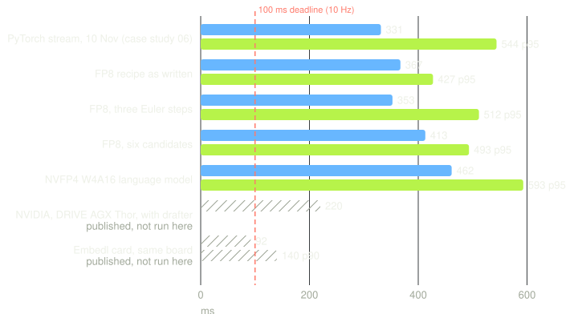

# Case study 07: Alpamayo 2 Edge with TensorRT Edge-LLM on the Jetson AGX Thor

**Status (2026-11-12, lab day 1):** NVIDIA's deployment recipe for Alpamayo 2 Edge
runs on the jetson-agx-thor and writes the same chain of causation as NVIDIA's own
example. As written (FP8 engines, greedy decoding because the drafter is not
released) it is slower at the median than the tuned PyTorch stream of case study 06
and faster at the tail. Moving the language model to NVFP4 W4A16, Embedl's precision,
made it slower on this software stack and changed the chain on two of nine clips. The
numbers Embedl publishes for this board (91.9 ms median) are not reached with the
public pieces available today; what stands between is listed at the end.

The report, every chart from the committed runs: [report/index.html](https://obiedeh.github.io/bench2field/case_studies/07_alpamayo2_edge_edgellm/report/index.html) (the file itself is `report/index.html`, built by `tools/make_report.py`, works offline).



Question, budget and protocol: [PLAN.md](PLAN.md). Every issue in the order it
happened: [FRICTION_LOG.md](FRICTION_LOG.md). Run records: `runs/` (every decision
with stage times and board power; one decoded trajectory set per clip and build).

## What was run

| Item | Value |
|---|---|
| Model | `nvidia/Alpamayo2-Edge`, revision aaaa32c6 (2.65 B parameters counted: 1.96 B language model, 0.41 B SigLIP2 vision encoder, 0.2 B action expert) |
| Recipe | `NVlabs/alpamayo-recipes` `recipes/alpamayo2edge_edgellm` (622f9d2, 2026-11-10), TensorRT Edge-LLM v0.11.1 |
| Board | jetson-agx-thor, JetPack 7.1, TensorRT 10.13.3.9, CUDA 13.0, MAXN; the recipe targets DRIVE AGX Thor with DRIVE OS 7.2.7 and TensorRT 11.3.1.9 |
| Host | rtx-5090-workstation: FP8 and NVFP4 calibration, ONNX export, inputs |
| Clips | the eight of case studies 02 and 06 (t0 5.1 s, derived navigation text) and NVIDIA's example clip (ea7bbd31, "Turn right in 30m") |
| Decode | greedy; the DFlash2 drafter the recipe uses for its 220 ms is "not part of the model release" |

## Results

Per decision, back to back, engines loaded once (`tools/thor_stream.py`), five Euler
steps, rolling vision cache (the six newest frames encoded per decision), board power
by tegrastats at 100 ms. "Nine clips" is 20 decisions on each of the nine; "example"
is 180 decisions on NVIDIA's example clip, Embedl's method.

| Build | Candidates | Clips | Median | p95 | Energy per decision | Record |
|---|---|---|---|---|---|---|
| FP8 recipe as written | 6 | example | 516 ms | 525 ms | 38.6 J | `runs/stream/example_rolling_c6.json` |
| FP8, cold cache (22 frames) | 6 | example | 525 ms | 613 ms | 46.4 J | `example_cold_c6.json` |
| FP8 | 6 | nine | 413 ms | 493 ms | 33.4 J | `clips9_rolling_c6.json` |
| FP8 | 1 | example | 399 ms | 458 ms | 32.6 J | `example_rolling_c1.json` |
| FP8 | 1 | nine | **367 ms** | **427 ms** | 29.1 J | `clips9_rolling_c1.json` |
| NVFP4 W4A16 language model | 1 | example | 576 ms | 584 ms | 41.5 J | `example_rolling_c1_nvfp4-w4a16.json` |
| NVFP4 W4A16 | 1 | nine | 462 ms | 593 ms | 37.2 J | `clips9_rolling_c1_nvfp4-w4a16.json` |
| NVFP4 W4A16 | 6 | nine | 512 ms | 627 ms | 42.2 J | `clips9_rolling_c6_nvfp4-w4a16.json` |
| FP8, three Euler steps | 1 | nine | 353 ms | 512 ms | 29.4 J | `clips9_rolling_c1_s3.json` |

For comparison, on the same board: case study 06's PyTorch stream (acceleration,
vision reuse, five steps, FP8, MAXN, one sample) 331 ms median and 544 ms p95; NVIDIA's
indicative DRIVE AGX Thor figure about 220 ms with the drafter; Embedl's card 91.9 ms
median, 140.3 ms p90, 12.45 J (NVFP4 language model, MXFP8 vision and expert, caches,
speculation), with their own FP16 Edge-LLM engines at 489 ms.

### Where a decision's time goes (FP8, one candidate, nine clips, medians)

| Stage | ms | Note |
|---|---|---|
| Vision encoder, 6 new frames | 25 | 98 with all 22 frames |
| Prefill, about 3,260 tokens | 95 | |
| Chain of causation, greedy | 207 | 11.8 ms per token of GPU work; 6 tokens on the four "nominal" clips, 19 to 26 on the five that reason |
| Expert K/V copy | 1 | 3 with six candidates |
| Action expert, 5 steps | 35 | 84 with six candidates |

Four of the nine clips take the model's no-reasoning path (`<NOMINAL>`, 6 tokens) and
finish in about 220 ms; the five that write a sentence take 370 to 430 ms. The floor
with no reasoning at all (vision, prefill, expert) is about 155 ms at one candidate.

### Accuracy across builds

Chain of causation: the FP8 engines reproduce NVIDIA's example sentence word for word
("Decelerate and turn right at the intersection to follow our route, as the roadway is
clear."). The NVFP4 W4A16 build changes the sentence on two of nine clips (the example
clip: 25 tokens instead of 22; clip 030c760c: 27 instead of 26) and leaves the other
seven unchanged.

Trajectories, decoded with the recipe's `host/compare.py`, ADE in metres over the 64
points, same noise seed across builds (`runs/results/cross_*.json`):

| Comparison | ADE, first candidates | Note |
|---|---|---|
| FP8 six candidates against FP8 one candidate | 0.002 to 0.011 | the two action engines agree |
| FP8 against NVFP4 W4A16 | 0.008 to 0.329 | largest on clip 0347d9f9 |
| FP8 five steps against three steps | 0.035 to 0.192 on eight clips, 0.596 on 195f1fc6 | |
| Spread among the six FP8 candidates, same clip | mean 0.70 to 1.66, max 1.70 to 4.14 | the study's budget for the rows above |
| FP8 against case study 06's PyTorch BF16 waypoints | 0.19 to 1.52 | different noise seed (43 against 0), one PyTorch sample: a sanity bound, not a quantization error |

Both the NVFP4 and the three-step differences sit inside the spread among the model's
own candidates. A like-for-like PyTorch reference needs the same noise tensor fed to
both runtimes; not done here.

## What was optimized, and what each change bought

1. **NVIDIA's recipe on the Jetson board.** Two adaptations: the JetPack TensorRT
   package instead of a DRIVE OS SDK tarball, and nvcc pinned to the CUDA 13.0 toolkit
   because the toolchain file takes the `cuda` alternative, 13.2 on this board, against
   the 13.0 headers (FRICTION_LOG, issue 2). Result: tail latency 544 to 427 ms against
   the PyTorch stream; median 331 to 367 ms, so no gain at the median.
2. **Vision cache across decisions** (the recipe's `--rolling` on a loop): the vision
   stage 98 to 27 ms, the p95 613 to 525 ms and 8 J less per decision against encoding
   all 22 frames; the median moved only 9 ms on the example clip because the cold run
   decoded faster there (`runs/stream/example_cold_c6.json`).
3. **One candidate instead of six:** expert 84 to 35 ms, about 45 ms per decision.
4. **NVFP4 W4A16 language model:** negative. Decode 11.8 to 15.0 ms per token, prefill
   96 to 129 ms, vision 25 to 35 ms (the projector was quantized too). The engine's
   weights are packed (1.35 GB against 1.96 GB), so the halved bytes are real; the
   single-token GEMV kernel on this stack does not turn them into time, and W4A16 adds
   dequantization work to the compute-bound prefill. W4A4, the tensor-core FP4 path,
   does not build on TensorRT 10.13 (issue 7).
5. **Token kept on the GPU, end of chain checked per chunk** (`tools/fast_runtime.py`):
   negative, no change; the host round trip was never the cost.
6. **Three Euler steps instead of five:** expert 35 to 25 ms; median 367 to 353 ms on the
   nine clips; trajectories within 0.2 m of five steps on eight clips, 0.6 m on one. The
   p95 (512 against 427 ms) is one clip running 80 ms slower in this set with the same
   token count, run-to-run variance rather than the step count; kept as measured.

Not done: speculative decoding (no Edge drafter released; training one with NVIDIA's
SpecForge recipe is a project of its own), MXFP8 on the expert and the vision encoder
(the recipe's action graph exporter is FP8-only), K/V reuse across decisions (the
prompt interleaves old and new frames per camera, so unchanged frames are not a
prefix), and pinned CPU clocks (`jetson_clocks` needs root on the board).

## Issues found

Seven, with causes, in [FRICTION_LOG.md](FRICTION_LOG.md). The ones a developer should
know before starting:

1. The recipe's submodule step must be recursive or the Edge-LLM build dies on a
   missing xgrammar header.
2. The toolchain forces nvcc from `/usr/local/cuda`; with two CUDA toolkits installed
   the launch stubs and headers disagree and every CUDA file fails to compile.
3. The action engine is exported for a fixed six candidates; a one-candidate export
   writes `candidates_per_sequence 2` and the builder computes zero sequences.
4. The shim renames the MLP layers but copies `hf_quant_config.json` verbatim, so a
   MIXED_PRECISION (NVFP4) config loses every per-layer entry and torch.export fails
   on a shape mismatch.
5. The NVFP4-A16 GEMM kernels exist only when the plugin is built with
   `-DENABLE_CUTE_DSL=ALL`; the recipe's build script leaves the default.
6. TensorRT 10.13 cannot build the W4A4 graph (Myelin, `PLUGIN_V3` with empty
   producers).
7. A first probe reported 1.1 ms per decode token; it was a timing bug in the probe,
   corrected to 11.8 ms, and the wrong number was withdrawn the same hour.

## Reproduce

Host (rtx-5090-workstation), weights and work under `/mnt/backup`:

```bash
bash tools/run_host_steps.sh            # inputs, shim, FP8 calibration, vocab, ONNX (about 2 min)
bash tools/make_inputs_owner_clips.sh   # the eight case-study clips
bash tools/run_host_nvfp4.sh            # NVFP4 variants (fix hf_quant_config.json first, FRICTION_LOG issue 5)
```

Board (jetson-agx-thor), recipe copied to `~/alpamayo2-edge-edgellm-work/recipes/`:

```bash
bash tools/thor_setup_jetson.sh                    # venv, system TensorRT bindings, CUDA 13.0 env.sh
source ~/alpamayo2-edge-edgellm-work/work/env.sh   # then thor/build.py and thor/build_action.py as in the recipe README
RECIPE_THOR=<recipe>/thor python tools/thor_stream.py engines/fp8 out.json inputs/<clip> --repeats 180 --candidates 6 --steps 5
```

`thor/build.py` needs `-DEMBEDDED_TARGET=jetson-thor`, `-DCUDA_DIR` for the 13.0
toolkit and `-DENABLE_CUTE_DSL=ALL`; `thor/run.py` writes "DRIVE AGX Thor" as the
platform. The exact edits are in FRICTION_LOG.md.
